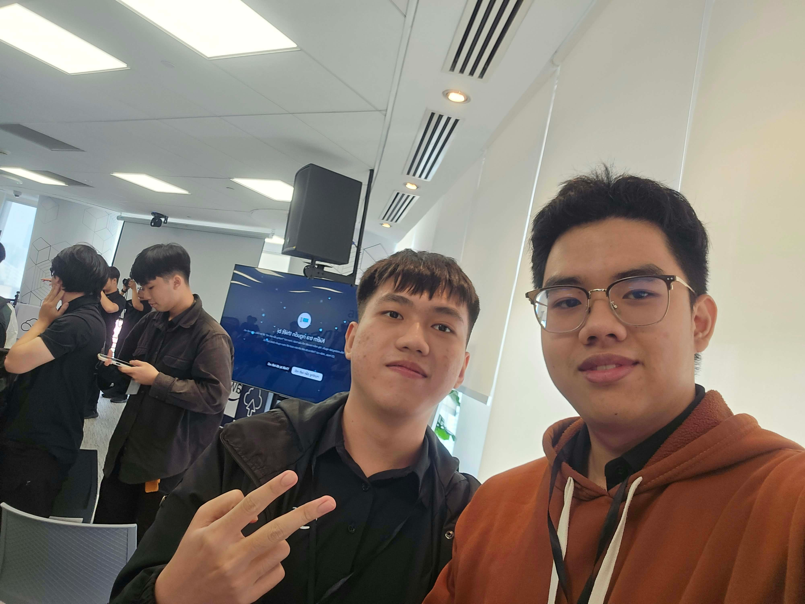

# Bài thu hoạch “AWS First Cloud Journey AI - Technical Deep Dives”

### Mục Đích Của Sự Kiện

- Tìm hiểu cách xây dựng contact center Voice-AI tiếng Việt trên AWS sử dụng kiến trúc cascade và duplex.
- Hiểu về AWS Resource Access Manager (RAM) để chia sẻ tài nguyên an toàn giữa nhiều tài khoản và thiết kế landing zone.
- Tìm hiểu về bảo mật ứng dụng web với AI-powered autonomous security agent.
- Giới thiệu về kiến trúc Runtime và Memory của Amazon Bedrock AgentCore.

### Danh Sách Diễn Giả

- **Kiet Tran** – AI Engineer, Revve AI
- **Thinh Nguyen** – DevSecOps/Cloud Engineer
- **Xuan An** – Leader, AWS Student Builder Group HCMUTE

### Nội Dung Nổi Bật

#### Xây dựng Vietnamese Voice-AI Contact Center (Revve AI)

- **Vấn đề**: Contact center đối mặt với lưu lượng truy cập tăng đột biến, tác vụ lặp lại và QA hạn chế. Gap turn-taking của con người là ~200ms.
- **Ba kiến trúc**: 
  - **Cascade (ASR → LLM → TTS)**: Text ở giữa đóng vai trò checkpoint. Kiểm soát/guardrails mạnh, tốt nhất cho tiếng Việt (production today).
  - **Speech-to-Speech (S2S)**: Một model, audio in → audio out (ví dụ: Nova 2 Sonic). Độ trễ thấp hơn, giữ được ngữ điệu, nhưng hỗ trợ tiếng Việt hạn chế.
  - **Full Duplex S2S**: Hai luồng luôn mở (ví dụ: Gemini Live). Độ trễ thấp nhất, có backchanneling, nhưng kiểm soát yếu nhất và chủ yếu chỉ hỗ trợ tiếng Anh.
- **Kiến trúc Revve trên AWS**: Một region, nằm trong tài khoản của khách hàng. Sử dụng EKS, GPU nodes (G6/L4) cho speech, và Bedrock qua PrivateLink cho LLM.
- **Kết quả Bank POC**: 799 cuộc gọi thử nghiệm, 93% intent match trên 871 labelled turns, 35/35 outbound outcomes được phân loại đúng.
- **Bốn bài học đắt giá**: 
  1. Benchmark turn detection bằng ngôn ngữ của bạn (padding mismatch giữa tiếng Việt và tiếng Anh).
  2. Chuẩn hóa số trước khi TTS (ví dụ: "500K" → "ca").
  3. Sử dụng small judge model để kiểm tra câu trước khi TTS nhằm ngăn output xấu.
  4. Latency budget quyết định model (Self-hosted Gemma: 0.24s vs Hosted: 1.15-1.95s).

#### AWS Resource Access Manager (RAM) Fundamentals

- **Thách thức Multi-Account**: Không chia sẻ, tài nguyên (Transit GW, DNS rules) bị duplicate ở mọi account, dẫn đến drift và chi phí cao. AWS RAM cho phép tạo một lần và chia sẻ ở mọi nơi.
- **Core Concepts**: Resource share là Regional container chứa **Resources** (ARNs), **Managed Permissions** (người dùng có thể làm gì), và **Principals** (ai được truy cập: accounts, OUs, org).
- **Deep Dive**: 
  - RAM là Regional; global resources (như Cloud WAN) chỉ được share từ us-east-1.
  - AZ names được map ngẫu nhiên theo account; luôn sử dụng **AZ IDs** (ví dụ: `use1-az4`) trong IaC cho shared subnets.
- **Enterprise Blueprint**: Management account bật org sharing. Infrastructure và Security OUs chia sẻ tài nguyên (Subnets, TGW, Firewall policies) cho Workloads OU (Prod/Non-prod/Data & AI) tự động qua membership.
- **Operations**: Giám sát bằng EventBridge (alert khi có external principals) và CloudTrail (source of truth). Quản lý dưới dạng code bằng CloudFormation hoặc Terraform.

#### Bảo mật Web Apps với AWS Security Agent

- **Security Bottleneck**: Manual pentests tốn thời gian (nhiều tuần), đắt đỏ ($5k-$20k/engagement) và không nhất quán.
- **Frontier Agent**: Được hỗ trợ bởi Amazon Bedrock. Có autonomous reasoning, bao phủ full lifecycle (Design Review → Code Security → Active Pentesting), và verifiable findings (thử khai thác thực tế).
- **Khả năng**:
  - **Design Review**: Upload Markdown/Terraform, xác minh với Managed Packs (PCI DSS, NIST CSF). Free Tier: 200 reviews/month.
  - **Code Review**: Tích hợp vào GitHub/GitLab PRs, comment trên code, gợi ý auto-fixes. Free Tier: 1,000 PR reviews/month.
  - **Automated Pentesting**: Multi-step exploit chains (IDOR → XSS), xác thực như người dùng thật, cung cấp attack graphs.
- **Pricing**: $50 per Task-Hour (pay-as-you-go). Case study thực tế: Tổng chi phí $1,500 - $2,500 so với $10,000 cho pentest team.
- **Critical Limitations**: Auth blocks (MFA, Biometrics, mTLS chặn agent), khó phát hiện business-logic fraud nếu thiếu context sâu, và task-hour accumulation trong các app phức tạp.

#### Amazon Bedrock AgentCore

- **Giới thiệu**: AWS Bedrock AgentCore Unpacked: Master Class về kiến trúc Runtime và Memory. *(Lưu ý: Chỉ có slide tiêu đề)*

### Những Gì Học Được

#### Chiến lược Voice AI

- **Control vs. Naturalness**: Đối với enterprise/banking bằng tiếng Việt, kiến trúc **Cascade** là lựa chọn production-ready duy nhất do nhu cầu text-based guardrails và hỗ trợ ngôn ngữ. Duplex đang trên lộ trình cho các pilot.
- **Latency Budget**: Lựa chọn LLM (self-hosted vs. hosted) được quyết định bởi latency budget có thể chấp nhận được.

#### Kiến trúc Multi-Account

- **Share, don't duplicate**: Sử dụng AWS RAM để duy trì một resource, một owner và một policy set.
- **Lean on Organizations**: Sử dụng OU-targeted, invitation-free, membership-driven access để tự động scaling.
- **Least Privilege**: Layer RAM managed permissions với consumer IAM policies và SCPs.

#### AI trong Bảo mật

- **Shift Left**: AI agents có thể thực hiện design và code reviews sớm trong SDLC, giảm đáng kể chi phí và thời gian của security audits.
- **Verifiable Findings**: Khác với LLM chatbots thông thường, security agents thử khai thác thực tế cung cấp bằng chứng về lỗ hổng.

### Ứng Dụng Vào Công Việc

- **Voice AI**: Đánh giá kiến trúc cascade cho tự động hóa dịch vụ khách hàng, đảm bảo các model STT/TTS tiếng Việt được benchmark locally.
- **Cloud Infrastructure**: Triển khai AWS RAM cho shared VPCs, Transit Gateways và DNS rules giữa các account development và production. Pin shared subnets vào AZ IDs trong Terraform/CloudFormation.
- **DevSecOps**: Tích hợp AI security agents vào workflows GitHub/GitLab để tự động hóa PR reviews và xác minh design theo compliance frameworks.
- **Agent Development**: Khám phá Amazon Bedrock AgentCore để xây dựng các AI agents nâng cao với persistent memory và runtime management.

### Trải nghiệm trong event

Tham gia sự kiện **AWS First Cloud Journey AI** là một trải nghiệm cực kỳ bổ ích, cung cấp cái nhìn toàn diện về cách AI và kiến trúc cloud hiện đại đang giải quyết các vấn đề enterprise thực tế. Một số trải nghiệm nổi bật:

#### Học hỏi từ các chuyên gia trong ngành
- **Kiet Tran** chia sẻ những bài học thực tế từ việc triển khai voice AI tiếng Việt tại một ngân hàng hàng đầu, nhấn mạnh tầm quan trọng của benchmarking theo ngôn ngữ cụ thể và trade-offs giữa các model cascade và duplex.
- **Thinh Nguyen** trình bày cách AI đang chuyển đổi landscape bảo mật, chuyển từ manual, expensive pentests sang autonomous, verifiable agent-based testing.

#### Hiểu sâu về kiến trúc kỹ thuật
- Session **AWS RAM** cung cấp blueprint rõ ràng cho enterprise landing zones, nhấn mạnh chi tiết quan trọng là sử dụng AZ IDs thay vì AZ names cho subnet sharing cross-account.
- Sơ đồ kiến trúc **Revve trên AWS** minh họa mô hình triển khai thực tế, an toàn bằng cách sử dụng PrivateLink cho Bedrock và GPU nodes cho speech processing trong tài khoản của khách hàng.

#### Bài học thực tế
- Hiểu rằng **latency budgets quyết định lựa chọn model** trong voice AI; một model self-hosted 0.24s khác biệt rất lớn so với model hosted 1.95s trong ngữ cảnh hội thoại.
- Nắm được cách tiếp cận **defense-in-depth** trong AWS RAM, nơi consumer IAM và SCPs vẫn được áp dụng trên permissions của shared resource.
- Nhận ra **giới hạn của AI security agents**, đặc biệt là khả năng bypass MFA hoặc hiểu business logic sâu, củng cố nhu cầu giám sát của con người trong các kịch bản phức tạp.

#### Một số hình ảnh khi tham gia sự kiện

> Tổng thể, sự kiện cung cấp một cái nhìn chuyên sâu, kỹ thuật về các dịch vụ AWS tiên tiến, từ voice AI và resource sharing đến autonomous security agents, định hình lại cách tôi hiểu về việc xây dựng các hệ thống an toàn, scalable và thông minh trên cloud.