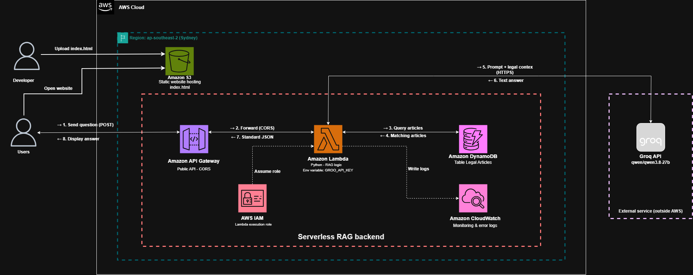

#### Concepts
+ **RAG (Retrieval-Augmented Generation)**: retrieve relevant text first (Retrieval), add it to the prompt (Augmentation), then let the model answer from that text only (Generation).
+ **Knowledge base on DynamoDB**: legal articles are stored as items in a DynamoDB table and found by keyword. It is simple and fits the AWS Free Tier, but it does not understand meaning the way vector search does.
+ **Serverless**: Lambda, API Gateway and DynamoDB scale automatically and charge by usage, which fits a low-budget project.
+ **Groq API**: an external inference service that runs the language model (`qwen/qwen3.8-27b`) and is called from Lambda over HTTPS.

#### Problem and goals
Employees need fast answers about personal-data rules (for example, using customers' ID card data for advertising). A public chatbot may invent articles or citations. Goal: answers grounded only in the legal text the team provided, running at near-zero cost on AWS.

#### Architecture and data flow

#### Data flow
1. The user opens the website on S3, types a question in the chat box and sends it. `index.html` sends an HTTPS POST request to API Gateway.
2. API Gateway checks CORS and forwards the payload to the Lambda function.
3. Lambda queries the DynamoDB table `LegalArticles` for articles related to the question (function `retrieve_legal_context`).
4. DynamoDB returns the matching articles to Lambda as legal context.
5. Lambda builds a complete prompt (system prompt + legal context + question) and calls the Groq API.
6. Groq returns the generated text answer to Lambda.
7. Lambda formats the standard JSON response (with error codes if needed) and returns it to API Gateway.
8. API Gateway returns the result and the chat box displays it. Lambda logs go to Amazon CloudWatch throughout.

#### Components
| Component | AWS service / resource |
| :--- | :--- |
| Prompt & RAG logic | Lambda (Python) |
| Knowledge base | DynamoDB – LegalArticles |
| Backend API | API Gateway + Lambda |
| Frontend | S3 static website – index.html |
| Security & operations | CloudWatch, Budgets, IAM |

#### Implemented vs. planned
The system differs from the first design in several places. This table keeps the workshop honest about what exists today.

| Area | First design | Implemented now |
| :--- | :--- | :--- |
| Knowledge base | S3 + Bedrock Knowledge Bases | DynamoDB table LegalArticles (keyword lookup) |
| LLM | Amazon Bedrock | Groq API (external, outside AWS) |
| Frontend | AWS Amplify | S3 static website |
| Authentication | Cognito | None yet (public API) |
| Response format | Structured: risk level, provisions, evidence... | Text answer wrapped in JSON |
| Conversation history | DynamoDB | Not implemented |
| Incident report + alert | SNS | Future work |

#### AI safety principles
+ Preliminary assessment only, never an official legal conclusion.
+ Answer only from the provided legal articles; never invent provisions or citations.
+ No basis in the database → say so explicitly.