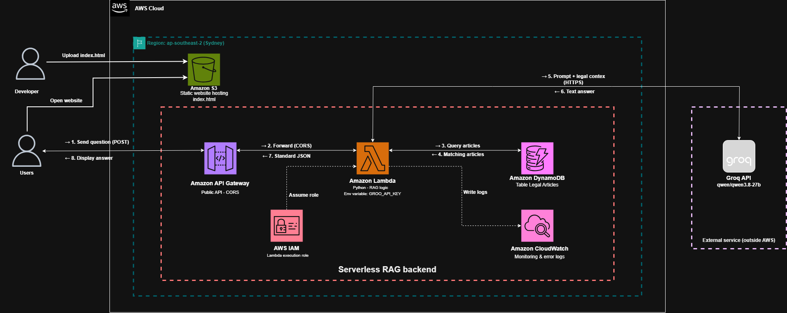

#### Khái niệm
+ **RAG (Retrieval-Augmented Generation)**: truy xuất đoạn văn liên quan trước (Retrieval), đưa vào prompt (Augmentation), rồi để mô hình trả lời chỉ dựa trên đoạn văn đó (Generation).
+ **Cơ sở tri thức trên DynamoDB**: các điều luật được lưu thành item trong bảng DynamoDB và tìm theo từ khóa. Cách này đơn giản và nằm trong AWS Free Tier, nhưng không hiểu ngữ nghĩa như tìm kiếm vector.
+ **Serverless**: Lambda, API Gateway và DynamoDB tự co giãn và tính phí theo mức dùng, phù hợp dự án ngân sách thấp.
+ **Groq API**: dịch vụ suy luận bên ngoài chạy mô hình ngôn ngữ (`qwen/qwen3.8-27b`), được Lambda gọi qua HTTPS.

#### Vấn đề và mục tiêu
Nhân viên cần câu trả lời nhanh về quy định dữ liệu cá nhân (ví dụ dùng dữ liệu CCCD của khách hàng để gửi quảng cáo). Chatbot công cộng có thể bịa điều luật hoặc trích dẫn. Mục tiêu: câu trả lời chỉ bám vào văn bản pháp luật nhóm cung cấp, chạy trên AWS với chi phí gần như bằng 0.

#### Kiến trúc và luồng dữ liệu

#### Luồng dữ liệu
1. Người dùng mở website trên S3, gõ câu hỏi vào khung chat và gửi. `index.html` gửi HTTP POST qua HTTPS tới API Gateway.
2. API Gateway kiểm tra CORS và chuyển payload vào hàm Lambda.
3. Lambda truy vấn bảng DynamoDB `LegalArticles` để tìm điều luật liên quan tới câu hỏi (hàm `retrieve_legal_context`).
4. DynamoDB trả các điều luật phù hợp về Lambda làm ngữ cảnh pháp lý.
5. Lambda đóng gói prompt hoàn chỉnh (system prompt + ngữ cảnh luật + câu hỏi) và gọi Groq API.
6. Groq trả nội dung câu trả lời dạng chữ về Lambda.
7. Lambda định dạng JSON chuẩn (kèm mã lỗi nếu có) và trả về API Gateway.
8. API Gateway trả kết quả và khung chat hiển thị. Log của Lambda được ghi vào Amazon CloudWatch trong suốt quá trình.

#### Thành phần
| Thành phần | Dịch vụ AWS / tài nguyên |
| :--- | :--- |
| Prompt & logic RAG | Lambda (Python) |
| Cơ sở tri thức | DynamoDB – LegalArticles |
| Backend API | API Gateway + Lambda |
| Frontend | S3 static website – index.html |
| Bảo mật & vận hành | CloudWatch, Budgets, IAM |

#### Đã triển khai và dự kiến
Hệ thống khác thiết kế ban đầu ở một số điểm. Bảng này giúp workshop nói đúng về những gì đang có.

| Hạng mục | Thiết kế ban đầu | Đang triển khai |
| :--- | :--- | :--- |
| Cơ sở tri thức | S3 + Bedrock Knowledge Bases | Bảng DynamoDB LegalArticles (tra theo từ khóa) |
| LLM | Amazon Bedrock | Groq API (bên ngoài AWS) |
| Frontend | AWS Amplify | S3 static website |
| Xác thực | Cognito | Chưa có (API công khai) |
| Định dạng phản hồi | Có cấu trúc: mức rủi ro, điều khoản, bằng chứng... | Câu trả lời dạng chữ bọc trong JSON |
| Lịch sử hội thoại | DynamoDB | Chưa triển khai |
| Báo cáo sự cố + cảnh báo | SNS | Hướng phát triển |

#### Nguyên tắc an toàn AI
+ Chỉ là đánh giá sơ bộ, không phải kết luận pháp lý chính thức.
+ Chỉ trả lời dựa trên các điều luật được cung cấp; không bịa điều luật hoặc trích dẫn.
+ Không có căn cứ trong cơ sở dữ liệu → nói rõ.